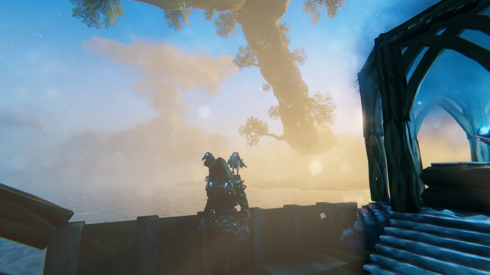
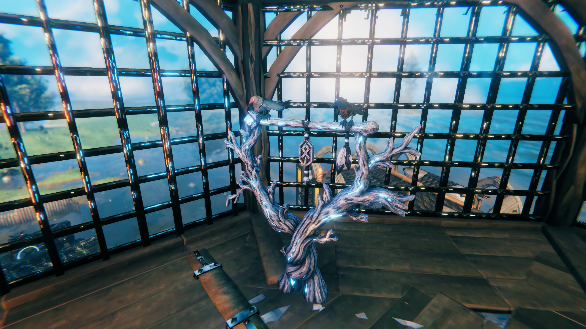
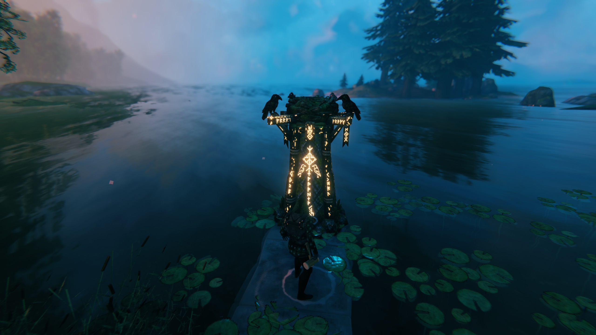
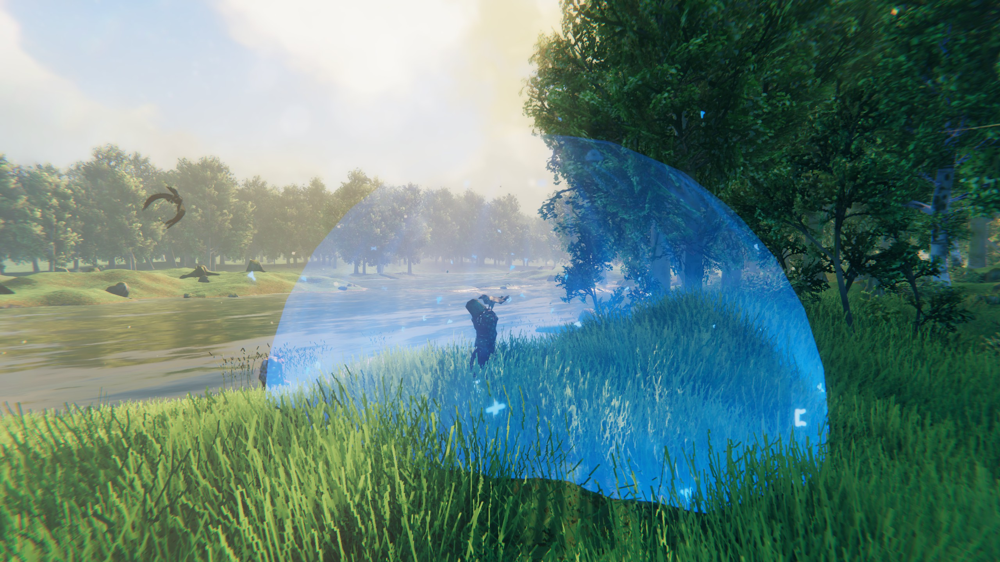
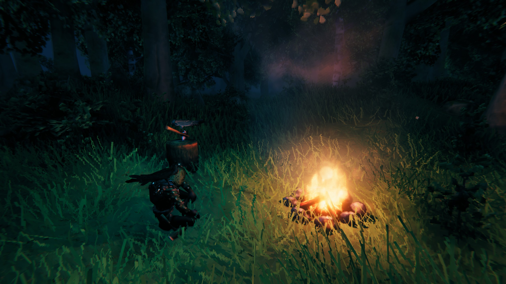

# RavenWatch — Hugin and Munin are watching you

**Odin's ravens live on your shoulders.** They fight beside you, scout, guard, carry mail and grow with you from boss to boss — and they have something to say about every step you take.

> **18+. This version contains strong language.** Munin swears a lot; Hugin doesn't — he cuts you down with words.

> **Optional voice addon: [RavenWatch_Voice](https://thunderstore.io/c/valheim/p/Ko4erga/RavenWatch_Voice/)** (a separate package) — the ravens say their lines aloud. RavenWatch never needs it.

English & Ukrainian · Works on vanilla · Multiplayer · [Discord](https://discord.gg/XM5kuwpAUU) — bugs, ideas, mistakes in the ravens' words · *Українською — внизу сторінки.*

---

## What is it

RavenWatch turns Hugin and Munin into your companions for the whole game. You get a sleeping raven, wake it with a boss-trophy ritual and raise it from level 1 to 7: it sits on your shoulder, comments on everything you do, fights and scouts for you, takes orders, carries mail and grows into Odin's own messenger.

- **Hugin** (right shoulder) — Odin's dry, condescending chronicler. Charges up in peace: crafting, exploring, resting by the fire.
- **Munin** (left shoulder) — Odin's memory and a foul-mouthed brute. Charges up in battle.

## Screenshots

| | |
|---|---|
|  |  |
| Hugin and Munin resting on a magic perch | The Raven's Nest — where Odin gives his errands |
|  |  |
| Hugin's gift «Under the Wing»: nobody gets hurt inside | By the fire the ravens tell what they remember |

## Killer features

### Munin fights beside you
Munin is the battle raven. His **Scream** knocks nearby enemies off balance and sends them running for a few seconds — a breather when you're surrounded. **Talons**: he dives at the enemies you're looking at and tears into up to three of them with his own strength, not your weapon's. **Fury** speeds up your swings, bow draw, crossbow reload and staff casts; **Tailwind** gives +50% speed to escape or catch up; **Mending** heals you to full; **Ward** puts a wall of runes in front of you that takes two hard blows (three at trust 6, four at 7), however hard — light hits don't wear it down. **Taming** (trust 3): aim at a wild beast and Munin lands on its head and breaks it in, swearing — while he sits it tames faster and attacks nobody. At trust 6 he unlocks **Munin's Beast**: you grow twice as big, stronger and tougher for a while — and then you're exhausted. When your health runs low, **Blood Rage** kicks in by itself. And from trust 5, when you die, **Blood Revenge** marks your killer: kill it soon after you are back on your feet and Munin returns the skills the death took — meanwhile he rises from your grave and circles over it.

### Hugin keeps you alive
Hugin is the clever one. **Decoy** makes an enemy forget you and fight only Hugin. **Shadow** turns you invisible — and the first hit from the shadow deals triple damage. **Last Chance** works on its own: a blow that would kill you leaves you at 1 health instead. From trust 5 **Omen** works on its own too: some mornings Hugin tells whether a raid comes before the next morning and which one, and the day's weather where you stand — turn the raid aside for a day, or call it right now when you want its trophies. **Under the Wing** raises a dome around you: monsters can only prowl its edge, and nobody inside can hurt anybody — time to heal, eat or let a friend get up. **Eye Peck** sends him straight at the target you're looking at.

### Scouting, light and flight
**Scouting**: Hugin flies up, looks around and marks on your map what he saw — enemies with their icons, ore deposits for the bosses you've beaten, dungeon entrances. **Light** hangs a glowing wisp over your head for dark caves and nights. **Leap** gives you long high jumps without fall damage — mountains and cliffs become shortcuts. At trust 6 **Odin's Wings** let you really fly for a while, with both ravens behind your back.

### Both ravens together
Some gifts need both ravens on your shoulders, and both pay for them. **Double Load**: they take part of your load and fly beside you, grumbling all the way, and a fall hurts you less. **Clear the Clouds**: they circle high overhead, and everyone near you gets a clear sky, while the Mistlands' mist pulls back. At trust 6 **Whirlwind**: they whirl round you and strike every enemy near without pause, until one of them runs out of strength.

### Strength comes from how you play
Every gift costs the raven's **strength**, and the two ravens charge up differently. **Hugin** charges in peace: crafting new things, chopping, mining, fishing, sailing, walking new lands, reading rune stones, resting by a fire. **Munin** charges in battle: kills, hits, wounds, bosses, narrow escapes. A builder and a fighter will each find "their" raven — and with both on your shoulders you're covered either way. A well-fed raven and one resting on a perch gather strength faster.

### A raven that grows with you
A raven starts asleep. You wake it with a ritual at Eikthyr's Sacrificial Stone, then raise it through **seven trust levels**: feed it, take it on adventures, and when the trust bar is full, perform a ritual with the next boss's trophies — the Elder, Bonemass, Moder, Yagluth, the Queen, Fader. Each level makes the raven visibly bigger, raises its strength from 100 to 300 and opens new gifts, gear and orders. Its strikes also grow with **training** and with every boss you beat together. Death, hunger and neglect cost trust — the raven is a real companion you have to look after.

### Odin's errands and runes
Build the **Raven's Nest**, lay offerings in its bowl and call Odin. When he answers, a raven flies up to him and returns with an **errand**: hunt a certain creature, kill a champion, bring an item, reach a place in the world or do a deed — with optional modifiers like "No death" for extra reward. Finished errands light **runes**: Freya's recolour your raven, Baldr's give it a steady aura, Heimdall's leave a trail in its flight. **Sparks of Odin** settle on runes, and then the runes give real bonuses — to the raven, to you in a fight or to your movement. After three runes Odin opens **golden errands**: Golden Runes raise your gifts for good. Between errands the ravens have **wishes of their own** — a treat, a trip to a land they miss, revenge on whatever hurt you, a cache to dig up, a fight to watch, a ride or a voyage, a look to wear, feathers or coins for the hoard — and kept wishes let you choose which rune gets the next spark.

### Bindrunes — a power you build yourself
At three **Raven Trees** in the world (Meadows, Mountains, Ashlands) you weave 2–4 of your runes into one **bindrune**. It reads as a sentence: Baldr's runes say **what** happens (a burst of fire, a frost wave, lightning at the nearest foes, healing, a poison cloud, enemies losing you, a shield…), Heimdall's say **when** (running, a dodge roll, a heavy hit, low health, a sneak attack, a kill, a parry…), Freya's say **how** (bigger radius, longer, twice, also heals friends, stronger at night…). Example: *lightning at the nearest foes — on a dodge roll — twice*. Everything scales with your weapon and health, so it stays useful from the Meadows to the Ashlands. To weave it you must survive waves of enemies around the tree.

### Orders
**J** opens the orders circle. Send a raven to **survey** the area, keep **beside** you, **circle** above, sit on a **perch**, or do **tricks**. Or aim at anything and choose **"There"**: the raven lands on a player, on a tamed animal, on a building, a ship or a cart (and rides along), or picks up a small item up to 2 kg and brings it to you.

### Gear with real effects
From trust 3 the raven has four gear slots — head, neck, back, legs. Things are crafted at two raven tables and each one does something: lose less trust, a bell that rings when enemies are near, cover for you while the raven is away, a stronger or faster strike, protection from cold, longer protective gifts, slower hunger, faster strength, faster flight, faster trust. The **feeding pouch** holds up to 5 pieces of food (the travel pouch 10), and the raven eats from it by itself when hungry. Hats it also brings from Odin after rituals.

### Perches — a home for your ravens
Nine perches in three tiers (simple, iron-bound, magic) to build at your base. Seat a raven with **E** and it rests and gathers strength — more under a roof and in comfort, up to 100 a day on a magic perch. You can call it back from anywhere in the world. Ravens on perches greet you, warn about enemies and talk to each other. Or leave a raven **at home** (**R**): off your shoulder without taking offence, it lives there, guards what it sees, eats from a feeder and tells you what it did when you come back. On the **Guard Perch** it stands guard.

### Raven post
Write a **letter** or pack a **parcel** (a small item or coins) and send it to any player on the server. Your raven flies to them across the world, hovers before their face and drops a sealed envelope or the parcel at their feet — then comes home.

### No two ravens alike
Each raven has its own **temper** (how it behaves on your shoulder and in the air), a **knack** — one thing it's especially good at — and a **quirk** you'll have to live with. It also gets a random **boon and burden** (rerollable with a Fate Stone), a **favourite food** it only hints at, and **nicknames** it earns over the journey.

### They speak, remember and talk to each other
The ravens react to what happens to you — deaths, kills, bosses, new biomes, close calls, building, sailing — with thousands of lines, using your name and the monsters involved. Each raven **remembers** your shared story and tells it back by the fire. With both ravens on your shoulders they **talk to each other**; ravens of different players talk when you meet. Some of them become friends and some can't stand each other — you'll see it in what they do. Now and then a raven picks a **victim** — another player, a tamed animal, a trader, the other raven or you — and mocks them for a few minutes: what they do, how they fall, a peck on the head (say no in the config if you'd rather not be picked). With the optional voice addon (a separate package, coming soon) they say it all aloud.

### The prologue and the Hall of the Watch
A stranger's raven calls you, two trails lead to your own raven, and an abandoned house keeps the Book of ravens. Then the Hall of the Watch: its gate shut, a woman named Heid with the key, a hearth that burns the wrong colour and an old letter about the Heart of home. The book's «Saga» tab keeps what happened, and who saw it.

### Settlers and the Heart of home
Build a Heart of home and it hears of people in trouble out in the lands. Save them and they come to live by it: they eat, sleep, work, talk, quarrel and dream, remember what you did and tell you the news. Hire them as guards, cooks, gatherers, smelters, beekeepers and more.

## Start in 5 steps

1. **Get a raven.** Buy **Hugin** or **Munin** from Haldor (1500 coins) — or wait: your own raven finds you in the prologue. Either way you can talk to a raven only with the **Book of Ravens**, and that book is found in the prologue: buy a raven early and the prologue calls you at once.
2. **Wake it.** A new raven sleeps. Hang Eikthyr's trophy on his Sacrificial Stone, bring **2 more Eikthyr trophies** and perform the ritual in the Book of Ravens (**B** → «Growth»).
3. **Put it on your shoulder** — right-click it in your bag.
4. **Feed it and take it along.** Trust grows; when the bar is full, a new ritual with the next boss's trophies opens the next level.
5. **Use it:** **Q** — gifts, **J** — orders, **B** — the Book of Ravens. A red **Guide** raven flies in and explains every new thing as it opens.

## Keys

| Key | What it does |
|---|---|
| **B** | Book of Ravens (change the key at the bottom of the «Gifts» tab) |
| **Q** | Gifts circle (right-click a gift to give it its own key) |
| **J** | Orders circle (right-click an order to give it its own key) |
| **G → «Ravens»** | The same gifts and the book from the radial menu |
| **Right-click** a raven in the bag | Put it on your shoulder (take it off with the button on its page in the book) |
| **E** / **Shift+E** at a perch | Seat Hugin / Munin, again — call it back |
| **R** / **Shift+R** at a perch | Leave Hugin / Munin there at home (taken back only with **E** at that perch) |
| **E** on a raven that flew in | Hear what it has to say |

## Installation and compatibility

- Install with a mod manager **on the server and for every player**. The server passes the ravens between players. **Everyone needs the same version.**
- Works fully on the **vanilla** game.
- **Path of Valheiman** — the ravens add up with its mechanics (sneak attack, attack speed, tree experience).
- **Language:** the mod speaks the game's language — Ukrainian in a Ukrainian game, English in any other; or pick it in the config (`0. Language`).

### Voice (optional)

RavenWatch is complete without it — every line shows as text on a speech card. Add **[RavenWatch_Voice](https://thunderstore.io/c/valheim/p/Ko4erga/RavenWatch_Voice/)** (a separate package) and Hugin, Munin and the Guide speak in their own voices; the words appear as the raven talks, nearby ravens take turns, voices fade with distance.

- Installing the voice pulls in RavenWatch automatically.
- Runs offline on your PC.
- **Ukrainian lines only for now.**
- Turn it down or off in the mod settings.

---

## Full guide

<b>A raven on your shoulder</b>

Haldor sells **Hugin the Raven** and **Munin the Raven** (1500 coins each). The ravens have **their own places — your shoulders**: Hugin always sits on the right, Munin on the left, as in the myths. Right-click a raven in your bag (or its hotbar key 1–8) to put it on your shoulder: it leaves your bag and sits there until you take it off with the button on its page in the Book of ravens. Your belt stays free for Megingjord, and both ravens can sit on you at once, no other mods needed.

**Your own raven.** You don't have to buy a raven. A while after you arrive, a strange raven calls you: follow the story and one of your own ravens finds you. Bought ravens are strays that once belonged to someone else. No trader sells the Book of Ravens: till the story gives it, a raven only sits on your shoulder.

**Haldor's goods.** Haldor also sells four things the raven craft can't do without, each once you have beaten its boss: **Haldor's Buckle** (after Eikthyr) for the strapped raven things, **Dvergr Brackets** (after Bonemass) for the sturdier perches and forged things, **Overseas Feathers** (after Moder) for the feathered and late things, and **Seer's Ink** (after Yagluth) for the advanced raven table, its runic things and the magic perches. He also sells **Odin's Call**: a raven flies to Odin with it for a few minutes and comes back in one of his gifts it missed — once on each trust level from 3 to 7.

**Your own raven.** A raven is loyal to whoever woke it. In someone else's hands it gives its gifts but doesn't grow, remembers nothing, only grumbles and pecks the stranger every minute. A lost raven can be brought back with a ritual at the Sacrificial Stones (Book of Ravens, the raven's page on the «Ravens» tab); the old copy, wherever it was left, then crumbles into feathers. No more than once every 5 days.

Every raven has **one random boon and one burden**. Some are plain numbers, others live their own life: Hugin may smell an unopened chest, mark raiders on the map or blurt something out right next to monsters; Munin may remember the kind that killed you, heal you on a kill or mock the trader into raising prices. About one raven in ten gets a **golden boon**, stronger than the rest. The ones that suit a raven's nature come up more often, and the raven shows them at work now and then. Don't like them? **Raven's Fate Stone** (1000 coins) rolls them again: you raise it to the raven, its sparks fly into the bird, and the raven shows what it thinks of its new fate. Every raven also has its own **nature**: a temper (how often it flies off by itself, what it's like on your shoulder and in the air; it shows more as trust grows), a knack — one strong side — and a quirk — a small habit you'll have to live with. And it has its own **pace in the air**: up to 20% slower or faster than its kind, in every flight (hungry or stuffed, it is slower). Now and then a raven is even of a **rare breed** — Albino, Rusty, Silverhead, Piebald, Golden-Eyed, or legendary Starborn, Wraith, Ember: it shows when it wakes, keeps its marks under any rune, and its knack card glows gold. Each breed also has a trait of its own: Rusty marks ore near you, Golden-Eyed warns of a foe behind your back, Starborn is stronger at night, Ember's strike burns, and so on. On top of that a raven picks up **habits** from how you have played these last days: share your mead often and it becomes a Mead-lover, stay home and it grows into a Homebird, fight a lot and it turns Warrior — seventeen in all, each with a plus and a minus, up to two at once. A habit stays at least five days and fades once you play differently; the book shows them under the nature row, and a hover tells how to lose one or keep it. Now and then a raven flies off to wash at the water's edge — sooner when it got dirty in a swamp, a fight or the bones — and back on your shoulder it shakes the water off onto you. It also plays tag with your tamed beast: by itself now and then, or when you look at the beast and press «Play» (the «Perch» button in the orders circle turns into it).

**Alive on your shoulder.** It turns its head to enemies and to what you're looking at, flaps its wings, caws when you're hit and hovers over you while you dance. Now and then it takes off to stretch its wings: follows you, circles over you or flies ahead on the road to scout — and comes back (not under a roof, in a dungeon or in a fight). Sometimes your two start a game of tag by themselves. It also touches the world by itself: reads signs, pecks berries, sits on fences and the mast (crying «Land!»), drinks at the water's edge, guards shiny things, sits on your grave and your bed, chases gulls and crows, warms itself by a fire, lands on a trader's head (and the trader grumbles), rides on someone else's ship or cart, gets jealous of Odin's raven. Hugin reads rune stones aloud and has his say on the old tale; Munin digs in bones and now and then brings you something from there. Back from an outing, a raven now and then brings you food from the land you are in — Hugin berries, mushrooms or honey, Munin meat or a small fish. By deep water or on a ship a raven now and then dives in with a splash and comes up with a fish: a hungry Munin eats it, otherwise it is yours. Put on a thing you never wore before, and a raven looks you over and has its say. A raven that went into your grave with your things circles over it or sits on the stone until you take it — and pecks any stranger who touches the grave.

<b>Taming, trust and satiety</b>

**Taming.** A freshly bought raven is asleep and doesn't know you. Hang Eikthyr's trophy on his Sacrificial Stone (as for the boss power), bring **2 more Eikthyr trophies** to the stones and perform the ritual in the Book of Ravens (tab «Growth»). The raven wakes up, flies to Odin and comes back as yours.

**Trust (levels 1–7).** Feed your raven when it's hungry (Hugin — berries, honey, mushrooms, fish; Munin — raw meat) and take it on your adventures. The food has to match the level: a raven eats food from up to one land past the last boss beaten, and from level 3 it no longer eats plain Meadows food. Food that doesn't fit is refused and stays with you; what it eats now is shown in the book. When the bar is full — a new ritual with 2 trophies of the next boss (The Elder, Bonemass, Moder, Yagluth, The Queen, Fader); that boss's trophy must already hang on his stone. With every level the raven grows, its gifts grow stronger, its strength grows from 100 to 300, and new things open: small gifts (level 2), great gifts (level 4) and **gear** (from level 3).

Dying, hunger and taking the raven off your shoulder cost trust. A death costs less at levels 1–2, and if you take your raven from your grave within 10 minutes, it gives half of that back.

**Satiety (0–100).** It melts by itself and with every gift. A hungry raven pays more strength for gifts, gathers no strength, steals food from your bag and even coins; a well-fed one gathers strength faster; a stuffed one gets lazy. The farther from home the food was found, the more filling it is. Each raven has its own **favourite food** — a secret at first: it hints at it when it asks for food. Below 15 the raven won't take orders, and at zero it **starves**: it sits glum, strikes half as hard, pecks you for 10 health every 30 minutes, and its trust melts.

<b>Gifts and strikes (Q)</b>

**Gifts** open up with trust (levels 1 to 6; what and when — in the book, tab «Gifts»). Open gifts are in the gifts circle (**Q**), in the radial menu **G → «Ravens»** or on their own keys. They spend the **raven's strength**: both gain a little every day by themselves, then Hugin charges up in peace and at work, Munin in battle.

| | Gifts | Charges up |
|---|---|---|
| **Hugin** | Thought · Scouting (map in 300 m, enemies and ore) · Light (a wisp over your head) · Decoy (an enemy fights only Hugin; trust 3) · Leap (high jumps, no fall damage) · Shadow (invisibility and a ×3 backstab) · Under the Wing (a dome: monsters circle its edge, nobody hurts anybody inside; trust 3) · Eye Peck (strikes the target you look at) · Odin's Wings (you fly, both ravens at your back; trust 6) · Light Step · Last Chance (saves you from a deadly blow) · Loyalty (may stay on your shoulder after death) · Omen (the day's raid and weather in the morning; trust 5) | **+10 a day; in peace:** new items and recipes, chopping, mining, fishing, swimming and travelling on foot, rune stones and Vegvisirs, skill levels, resting by a fire, new biomes and dungeons, traders; with Path of Valheiman — a new character level |
| **Munin** | Thought · Scream (enemies stagger and flee) · Fury (faster hits, bow, crossbow, staffs) · Tailwind (+50% speed) · Mending (to full health) · Ward (runes in front take 2–4 hard blows; light hits are free; trust 4) · Taming (sits on a wild beast: it tames faster; trust 3) · Talons (tears into up to 3 enemies you look at) · Munin's Beast (you grow twice as big, stronger and tougher, then tired; trust 6) · Anger · Blood Rage (at low health) · Stubbornness (may stay on your shoulder after death) · Blood Revenge (kill your killer, get your skills back; trust 5) | **+10 a day; in battle:** kills, hits on enemies, wounds from them, bosses, narrow escapes, your death; also new runes and Vegvisirs |

**Strikes** (Eye Peck, Talons) hit with the raven's own strength, not your weapon: it grows with **training** (every flight that hits; tab «Growth»), with trust and with every boss defeated with the raven on your shoulder. Training goes up to 30, and at 10, 20, 25 and 30 the raven learns a **technique** of your choice — one of four, for good, each for a way of fighting (archer, mage, tank, close combat).

**The gifts circle.** **Q** opens the round gifts menu: Munin on the left, Hugin on the right, strikes first at the top; inside — each raven's strength, in the middle — «Orders». Right-click a gift to give it its own key. Q steps aside while you build or look at something that has its own Q action.

Prices, cooldowns and everything each level gives — in the **Book of Ravens**.

<b>Orders (J)</b>

**J** opens the round orders menu: each raven's orders on his wing — Survey, «With Me», «Circle», «Perch», «There» and the Pouch; in the middle «Recall all», round it each raven's strength and satiety, with his food button at the end of the satiety stroke; under it «Tricks» drops the tricks below the circle (and «Tag» for both). A chip over each wing says where the raven is; an active order lights up with the time it has left. Right-click an order, perch or trick to give it its own key. Hold the key, point and release — or tap it and click. From trust 3 a thin row outside each wing holds the arm: «On the arm» (the raven sits on your forearm, Hugin on the right, Munin on the left); once it sits there — feed it from your hand, toss it up, and «Ways»: its own five of ten, one at trust 3 and one more at each next trust, different for every raven (each gives a little trust, ten a day at most). Your weapons and tools are put away; taking something in hand, a strike, a run or a blow sends it back to your shoulder, and in flight «On the arm» calls it back onto the arm.

**«There».** Aim at something and open **J** — the tile shows what will happen:

- a **player** — the raven sits on their head or a free shoulder (they shake it off with a roll);
- a **tamed animal** — on its back or head;
- a **small thing up to 2 kg** — it brings you one;
- a **perch** — it sits on it;
- a **building, rock, the ground, a ship or a cart** — it sits on top (and rides along with the ship or cart).

<b>Gear, the pouch and nicknames</b>

From trust 3 the raven has four slots — head, neck, back, legs (book, tab «Look»). Raven things are crafted at the two raven tables (the simple one near a forge, the advanced one near a galdr table; both in the hammer), and each gives the raven a power: less trust lost, a bell that rings on enemies, cover while the raven is out, a stronger or faster strike, protection from the cold, longer protective gifts, slower hunger, faster strength, faster flight, faster trust. Things from the advanced table go on from trust 5. Put a thing on with right-click in the bag (Shift+right-click — for Munin) or with a click in the book. Some hats open with trust, the rest the raven brings from Odin after rituals — each raven its own set. Missed one? Haldor sells **Odin's Call** (300 coins): squeeze it and the raven on your shoulder flies to Odin for a few minutes and comes back in a hat it missed — once on each trust level from 3 to 7.

**Pouch** (the Feeding Pouch from the simple table) goes on the raven's back. The «Pouch» button in the book opens it next to your bag: put up to 5 pieces (10 in the Travel Pouch) of that raven's food in it. When the raven gets hungry, it eats from the pouch by itself — and stays out of your bag.

**Nickname.** Every raven has its own nickname: a few plain ones and ones from its nature right away; the rest it earns together with you. Pick one on the «Look» tab. A new name takes 20% of the trust bar and is possible once every 3 game days; the first choice and one after each earned gold or legendary nickname are free. Other players see your raven under that name.

<b>Odin's errands, runes and bindrunes</b>

**The nest.** Build a **Raven's Nest** (hammer, RavenWatch tab; after Eikthyr, with 2 of his horns) and put your ravens in it (E on the nest at the top). Lay gifts in the bowl below and **call for Odin's Favour** — he doesn't always answer, and generous gifts make him kinder. When gold shines over the nest, Odin is here: accept his will — a raven flies up to him and comes back with an errand (about once a game day, sooner the more it trusts you): a hunt, a champion, a thing to bring, a place in the world or a deed. A hunt may ask for a way — a bow, magic, a surprise attack, a reeling foe, fire or frost — and then fewer kills are needed. Some let you pick one of two ways; some ask you to spare certain beasts for a day, from the next dawn; some give you Odin's feather to carry on foot to a mark and lay down there; some ask for a night watch in a rune ring, or have a raven lead you along a route. Such a step starts with E at its place, the orders circle (J) or the button in the book. Errands about a land come more often while you are in it, and they sound warmer once a raven trusts you. A trusting raven brings more errands of the land you are opening and fewer old ones; now and then Odin sends you a land further, for a bigger reward. Gifts in the bowl lean which errand comes. Errands are in the book (tab «Odin's Path»), the place is a blue circle on the map («Track»). Handing over a thing and giving up an errand happen at the nest's bowl.

**Runes.** Done errands cut notches into a tally stick, and five notches light a **rune**: Runes of Freya colour your raven, Runes of Baldr give it a steady effect, Runes of Heimdall a trail in flight; hang them on the «Look» tab, as diamonds around the raven.

**Modifiers.** Now and then an errand comes with a condition: «No Death», «No Scratches», «Haste», «On Foot» (no portals; only on far errands, and the farther the richer), «No Retreat» (don't run from a foe that hits you), «Quiet» (no fighting at night or in a storm). Keep it and a secret reward comes: notches or a Spark. Rarely Odin gives one of his own, in gold — «Odin's Vow» (no death, no portals) or «Trial of the Spark» (in time and alive) — and those bring a Spark for sure.

**Sparks of Odin.** An errand's modifier (like «No Death») may bring a Spark: it falls on a random rune and stays on it (up to three sparks), and then the rune is more than looks — Freya's strengthen the raven itself, Baldr's you in a fight, Heimdall's your movement (those two while the raven is on your shoulder).

**Golden Runes.** After three runes Odin also calls you to golden errands: Golden Runes raise your ravens' gifts for good.

**Bindrunes.** At the three **Raven Trees** in the world (Meadows, Mountains and Ashlands) your runes are woven into a **bindrune** (E on the roots; green tree 2 runes, icy 3, burnt 4, any kinds): your own power that reads as a sentence — Baldr's runes say WHAT happens, Heimdall's WHEN, Freya's HOW. To weave it you stand through an arena of enemy waves round the tree (other players may help). You have one bindrune at a time; it works on you (no raven wears it), with charges that come back over time; switch it off in the book or the gifts circle (Q), unweave it only at a tree.

<b>Raven post (multiplayer)</b>

The envelope in the corner of the Book of Ravens: a **letter** (up to 300 characters; 20 strength and a **Parchment**, Haldor sells them for 50 coins) or a **parcel** (one small thing up to 2 kg, or coins as a stack; 30 strength) to anyone on the server who has RavenWatch. You choose who carries it: a raven carries a letter from trust 2, a parcel from trust 3. It flies off, comes to them from afar, hangs before their face and hands it over: the letter falls as a sealed envelope — break the seal (or it opens by itself), the parcel drops at their feet. In a fight or with a window open it waits, but no more than 20 seconds. Not taken — it brings it back.

<b>Perches</b>

The hammer (RavenWatch tab) has nine raven perches in three tiers: simple (Simple Perch, Simple Wall Perch, Forged Gallows, Raven Awning), sturdier (Iron-Bound Perch, Banner Perch, Guard Perch) and magic (Magic Perch, Dvergr Perch). **E** at a perch seats Hugin, **Shift+E** — Munin; again — calls it back; or «Perch» in the orders circle: the raven finds the nearest free visible spot within 20 m. On a perch the raven rests and gathers strength — up to 30 / 60 / 100 a game day by tier; faster under a roof and in comfort. You can call it back from anywhere. Ravens on a perch greet you, grumble at strangers, warn about enemies and chat with each other. They live there like birds: they feel the cold, heat, thunder and dawn; a raven left there looks about, tenses at enemies and cries out before a blow; on a night watch it nods off, and two at home keep watch by turns; it is glad when you come back, gets bored without you and eyes the feeder when hungry.

**At home and on guard.** Looking at a perch, **R** leaves Hugin there for good, **Shift+R** — Munin; on the Guard Perch **E** does it too. The raven comes off your shoulder without taking offence and lives on the perch until you come and take it back yourself (**E** at that perch) — it cannot be called from afar. There it gathers a guard store first, then its own strength, slower than on a rest but up to the full. Once settled in, it strikes angry enemies it sees near the perch, paid from that store (cheaper on the Guard Perch, which also stands outside without losing anything to the open sky). It will not take up guard in the middle of a fight. It flies out only when fed: build a **feeder** nearby (simple, iron-bound or Odin's — the better one makes the same food go further) and put food of its kind in it — meat for Munin; fish, berries, mushrooms, vegetables and dishes of them for Hugin. Without a feeder it hunts by itself but stays hungry, and after days without one it feels forgotten and loses trust. A fed raven puts a find a day on the feeder's shelf. When enemies come while you are away, it calls you; when you come back, it tells what it did; the book shows where it is. If its perch is broken without you, it flies to Odin and comes back at the Sacrificial stones. Your two at home together spar and slowly train each other, and your raven now and then visits a friend raven on a perch nearby.

<b>Ravens that talk, remember and come by</b>

**Quick ravens.** Soon after a big moment (a boss, a death, a narrow escape, a new level, a new biome…) Hugin or Munin flies in and says one line with your name. Never in the middle of a fight. Once every 30–40 minutes; more often when a lot happens, but never sooner than 10 minutes apart. After a group fight (players within 50 m) at most two players get a raven. If your own raven sits on your shoulder, it says it from there.

**Shared ravens.** Players nearby see a raven that came to someone else: the bird, a title «Hugin → name» and the full line when its owner talks to it. A temporary map pin shows while the raven sits.

**Talks.** When both ravens are on your shoulders, now and then they talk to each other — on the road, by a fire, after a boss fight, in the rain or at night — in a bubble over your head. Ravens on different players' shoulders talk too: when you meet again after a while, after a boss you fought together and by the same fire.

**Ravens get along — or not.** Every two ravens of different players have a hidden bond, from their natures and from what they go through together; you learn it from what they do. Friends greet each other warmly, fly over to sit together, now and then visit each other by themselves and come back with gossip about the other player — and your two speak of that friend. Enemies quarrel with feathers flying and now and then steal a bite from the other player's bag. A friend raven brings a bite to a hungry one, and your own two share food with each other too. Friends fight as a pack: when both strike the same foe one right after the other, it takes a blow more — and when a foe goes for one of the two players, close friends sometimes fly at it together by themselves. At night by a fire, when ravens of several players are there, they sometimes fly off together, sit side by side and talk for a while. In the book, the seal by a raven's name shows the ravens it knows, how they get along and their story. Ravens also take to other players, each by its own character and how that player plays: someone it can't stand gets called names and now and then a peck on the head; someone it respects gets a warm word and a warning caw when hurt.

**Tag with another player.** Aim at another player and open **J**: «Tag» becomes «Tag for two». Pick one of your ravens — the other player gets an invitation and picks theirs with the mouse (or declines with the button or Esc). The two ravens chase each other above you for a minute or two, each at its own speed; every catch is a point, the roles change and the flight takes another shape (a ring, an eight, a snake, a hill). The winner sometimes gets a handful of coins (at most 3 times a game day), and 50 wins earn a golden nickname. Ravens at odds with each other won't play.

**Memory.** Each raven remembers what it saw from your shoulder: your first deaths together, bosses, biomes and dungeons, records, the ones who wronged you, fresh fights. When nothing is happening, and especially by a fire, it tells what fits the moment.

**The fight judge.** After a fight worth it — three foes or more, a strong one, or a lot of blood — the raven on your shoulder gives it from one to five stars: Munin mocks, Hugin names your main mistake. A fight like in the sagas earns a little trust, a good one may make the raven show you its hidden cache, and it remembers your best fight and where it was. At most once in a while.

**The victim.** Rarely (about one game day in twelve, and the same chance again for you) a raven of trust 2 and up picks someone within 30 m and mocks them for 3–10 minutes: another player, a tamed animal, a trader, the other raven — or you. Its jeers come in a venom-green card that shakes, with a cawing laugh, and it comments on what the victim does: a blow, a fall, a death, running off, sleeping, swimming, building. Once in a while it sits on their head for a whole minute, pecking and mocking non-stop — a line as soon as the last is read and nobody near is talking (1 HP a peck, never to death — PvP or not). A player with ravens of their own gets them snapping back. Hugin may foretell the victim a fall, a blow or a death — if it comes true he gains a little trust. The victim sees a message in the middle of the screen; «Other players ravens may mock me» in the config keeps their ravens off you, «Mockery chance» sets how often yours do it.

**The Guide.** A red Guide raven flies in whenever something new opens up for you, one short topic at a time; talk to it with E. What it told you can be read again in the book.

<b>Settings and line files</b>

`BepInEx/config/ko4erga.ravenwatch.cfg` — language, how often ravens visit and the pauses, Munin's chance, the reactive mode and the group limit (works on the server), the exclamation mark, shared ravens.

On a server the ravens' balance (prices, gift costs and cooldowns, strength, trust, satiety, rituals, food) comes from the server's settings, not from the players' files. Keys, talkativeness, looks and the book stay each player's own.

All the lines are in `BepInEx/config/RavenWatch/` (Ukrainian) and `BepInEx/config/RavenWatch/lang/English/` (English) — one line per row, editable without a restart:

| File | What's in it |
|---|---|
| `hugin_event_titles.txt`, `hugin_event_texts.txt` | Hugin on events: `[event] text` |
| `hugin_tails.txt` | short tails after a line |
| `hugin_quips.txt`, `munin_quips.txt` | ready lines after events: `[event] text` |
| `hugin_patterns.txt`, `munin_patterns.txt` | lines built from parts: templates `[event]` and lists `@part` (~1/~2/~3 — tone by trust) |
| `hugin_titles.txt`, `hugin_texts.txt` | Hugin's general lines |
| `munin_titles.txt`, `munin_texts.txt` | Munin |
| `creature_names.txt` | creature names — add monsters from other mods here |

An update never overwrites your lines — it only adds new events. Another language can be added the same way: `BepInEx/config/RavenWatch/lang/<Language>/`.

---

<b>Українською</b>

# RavenWatch — Хугін і Мунін стежать за тобою

**Ворони Одіна живуть у тебе на плечах.** Б'ються поруч, розвідують, захищають, носять пошту й ростуть разом із тобою від боса до боса — і мають що сказати про кожен твій крок.

> **18+. У цій версії є нецензурна лайка.** Мунін матюкається; Хугін не лається — він б'є словом.

> **Озвучка — окремий пакет за бажанням: [RavenWatch_Voice](https://thunderstore.io/c/valheim/p/Ko4erga/RavenWatch_Voice/)** — ворони говорять уголос. RavenWatch без неї повний.

Українська й англійська · Працює на чистій грі · Мультиплеєр · [Discord](https://discord.gg/XM5kuwpAUU) — баги, ідеї, помилки в словах воронів

## Що це

RavenWatch робить Хугіна й Муніна твоїми супутниками на всю гру. Ти отримуєш сплячого ворона, будиш його обрядом із трофеями боса й ростиш від 1-го до 7-го рівня: він сидить у тебе на плечі, коментує все, що ти робиш, б'ється й розвідує за тебе, виконує накази, носить пошту й виростає у справжнього посланця Одіна.

- **Хугін** (праве плече) — сухий зверхній літописець Одіна. Заряджається в мирі: ремесло, мандри, відпочинок біля вогню.
- **Мунін** (ліве плече) — пам'ять Одіна і грубіян, якого не спинити. Заряджається в бою.

## Головне

### Мунін б'ється поруч
Мунін — бойовий ворон. Його **Крик** збиває ближніх ворогів з рівноваги й змушує тікати на кілька секунд — передих, коли тебе оточили. **Кігті**: він кидається на ворогів, на яких ти дивишся, і рве до трьох із них власною силою, а не силою твоєї зброї. **Лють** прискорює удари, натяг лука, перезаряджання арбалета й посохи; **Попутний вітер** дає +50% швидкості, щоб утекти чи наздогнати; **Зцілення** лікує до повного здоров'я; **Заслона** ставить перед тобою стіну рун, що приймає один удар, хоч який сильний. **Приборкання** (довіра 3): наведи приціл на дику тварину — Мунін сяде їй на голову й, лаючись, ламає норов; поки він сидить, вона приручається швидше й ні на кого не кидається. З 6-го рівня відкривається **Звір Муніна**: на якийсь час твоє тіло вдвічі більше, сильніше й міцніше — а потім приходить втома. Коли здоров'я мало, сама вмикається **Кривава лють**. А з 5-го рівня, коли ти гинеш, **Кровна помста** позначає вбивцю: вбий його невдовзі після відродження — і Мунін поверне навички, які забрала смерть; а поки що він злітає з твоєї могили й кружляє над ним.

### Хугін тримає тебе живим
Хугін — розумник. **Обманка** змушує ворога забути про тебе й битися лише з Хугіном. **Тінь** робить тебе невидимим — і перший удар з тіні б'є втричі сильніше. **Останній шанс** спрацьовує сам: удар, що мав тебе вбити, лишає 1 здоров'я. З 5-го рівня так само сам працює **Віщування**: деякими ранками Хугін каже, чи прийде до наступного ранку набіг і який, і яка буде погода там, де ти стоїш, — набіг можна відвести на добу або накликати просто зараз, коли хочеш трофеїв. **Під крилом** ставить довкола тебе купол: монстри можуть лише кружляти біля краю, а всередині ніхто нікого не поранить — час підлікуватися, поїсти чи підняти друга. **Удар в очі** кидає його просто в ціль, на яку ти дивишся.

### Розвідка, світло й політ
**Розвідка**: Хугін злітає, роздивляється й позначає на мапі побачене — ворогів з їхніми значками, поклади руди для вже переможених босів, входи в підземелля. **Світло** вішає над головою світляк для темних ночей. **Злет** дає довгі високі стрибки без шкоди від падіння — гори й кручі стають коротким шляхом. З 6-го рівня **Крила Одіна** дають справжній політ, обидва ворони за спиною.

### Обидва ворони разом
Деякі дари потребують обох воронів на плечах, і платять за них обидва. **Подвійна ноша**: вони беруть частину твого вантажу й летять поруч, бурчачи всю дорогу, а падіння з висоти болить менше. **Розігнати хмари**: вони кружляють угорі, і в усіх довкола тебе ясне небо, а туман Туманних земель відступає. З 6-го рівня **Вихор**: вони кружляють довкола тебе й без упину б'ють усіх ворогів поруч, доки в одного з них не скінчиться сила.

### Сила — від того, як ти граєш
Кожен дар витрачає **силу ворона**, і заряджаються ворони по-різному. **Хугін** — у мирі: нові речі й рецепти, рубка, видобуток, риболовля, плавання, нові землі, рунні камені, відпочинок біля вогню. **Мунін** — у бою: вбивства, удари, рани, боси, «ледве вижив». Будівельник і воїн знайдуть «свого» ворона, а з обома на плечах тобі ніщо не страшне. Ситий ворон і ворон на жердині набираються сили швидше.

### Ворон, що росте разом із тобою
Ворон спершу спить. Ти будиш його обрядом біля Жертовного каменя Ейктюра, а далі ведеш через **сім рівнів довіри**: годуєш, береш у пригоди, а коли шкала повна — проводиш обряд із трофеями наступного боса: Старійшина, Кісткомас, Модер, Яґлут, Королева, Фейдер. З кожним рівнем ворон помітно більшає, сила росте від 100 до 300, відкриваються нові дари, спорядження й накази. Удари ворона ще й міцнішають з **вишколом** і з кожним спільним босом. Смерть, голод і недбалість забирають довіру — ворон справжній супутник, про якого треба дбати.

### Доручення Одіна й руни
Збудуй **Вороняче гніздо**, поклади дари в чашу й поклич Одіна. Коли він озветься, ворон злетить до нього й повернеться з **дорученням**: вполювати певну істоту, вбити ватажка, принести річ, дійти до місця у світі чи зробити справу — з модифікаторами на кшталт «Без смерті» за більшу нагороду. Виконані доручення запалюють **руни**: руни Фреї перефарбовують ворона, Бальдра дають йому сталу ауру, Геймдаля — слід у польоті. **Іскри Одіна** осідають на рунах, і тоді руни дають справжні бонуси — ворону, тобі в бою чи твоєму руху. Після трьох рун Одін відкриває **золоті доручення**: золоті руни назавжди посилюють дари. Між дорученнями ворони мають **власні прохання** — смаколик, мандрівку в край, за яким скучили, помсту кривдникові, схованку, яку треба відкопати, бій, на який хочуть подивитися, прогулянку верхи чи під вітрилом, вбрання, пір'я чи монети для скарбнички, — а виконані прохання дають самому обрати руну для наступної іскри.

### В'язі — сила, яку складаєш сам
Біля трьох **Воронячих дерев** у світі (Луки, Гори, Попелясті землі) ти сплітаєш 2–4 свої руни в одну **в'язь**. Вона читається як речення: руни Бальдра кажуть, **що** стається (спалах вогню, морозна хвиля, розряд у найближчих ворогів, лікування, хмара отрути, вороги (крім босів) гублять тебе, щит…), Геймдаля — **коли** (біг, перекат, сильна атака, мало здоров'я, удар зі скритності, вбивство, парирування…), Фреї — **як** (більший радіус, довше, двічі, лікує й друзів, сильніше вночі…). Наприклад: *розряд у найближчих ворогів — на перекаті — двічі*. Усе залежить від твоєї зброї й здоров'я, тож в'язь корисна від Луків до Попелястих земель. Щоб сплести, треба встояти проти хвиль ворогів довкола дерева.

### Накази
**J** відкриває коло наказів. Відправ ворона **облетіти** місцевість, триматися **поруч**, **кружляти** над тобою, сісти на **жердину** чи показати **трюки**. Або наведи на будь-що й обери **«Туди»**: ворон сяде на гравця, ручну тварину, будову, корабель чи віз (і поїде з ними) або підбере дрібницю до 2 кг і принесе тобі.

### Спорядження, що справді діє
З 3-го рівня в ворона чотири місця — голова, шия, спина, лапи. Речі майструються на двох столах ворона, і кожна щось робить: менше втрат довіри, дзвін, коли поруч вороги, прикриття, поки ворон у вильоті, сильніший чи швидший удар, захист від холоду, довші захисні дари, повільніший голод, швидша сила, швидший політ, швидша довіра. **Торба** вміщає до 5 шматків їжі (похідна — 10), і голодний ворон їсть із неї сам. Шапки він ще й приносить від Одіна після обрядів.

### Жердини — дім для воронів
Дев'ять жердин на три рівні (прості, окуті, магічні) для твоєї бази. Посади ворона клавішею **E** — і він відпочиває й набирається сили: під дахом і в затишку більше, до 100 за день на магічній жердині. Покликати його можна з будь-якого кінця світу. Ворони на жердинах вітають тебе, попереджають про ворогів і розмовляють між собою. Або лиши ворона **вдома** (**R**): він знімається з плеча без образи, живе там, стереже, що бачить, їсть із годівниці й розповідає, що робив, коли ти повертаєшся. На **Вартовій жердині** він стоїть на варті.

### Пошта воронів
Напиши **лист** чи збери **посилку** (дрібну річ або монети) й надішли будь-якому гравцеві на сервері. Твій ворон перелетить до нього через увесь світ, зависне перед обличчям і кине запечатаний конверт чи посилку під ноги — а потім повернеться додому.

### Двох однакових воронів не буває
У кожного ворона свій **характер** (який він на плечі й у повітрі), **хист** — те, що в нього виходить найкраще, — і **примха**, з якою доведеться жити. А ще випадкове **благо й тягар** (можна перекинути Каменем долі), **улюблена їжа**, на яку він лише натякає, і **прізвиська**, які він заслужить у дорозі.

### Говорять, пам'ятають і розмовляють між собою
Ворони відгукуються на те, що з тобою стається — смерті, вбивства, боси, нові біоми, «ледве вижив», будівництво, плавання — тисячами фраз, з твоїм ніком і назвами монстрів. Кожен ворон **пам'ятає** ваш спільний шлях і розповідає його біля вогню. З обома воронами на плечах вони **розмовляють між собою**; ворони різних гравців — коли ви зустрічаєтеся. Одні з них дружать, інші терпіти одне одного не можуть — це видно з того, що вони роблять. Зрідка ворон обирає **жертву** — іншого гравця, ручну тварину, торговця, другого ворона чи тебе — і кілька хвилин з неї глузує: що робить, як падає, ще й на голову сяде подзьобати (не хочеш бути жертвою — вимкни в конфігу). З окремим пакетом озвучки вони кажуть усе це вголос.

### Пролог і Зала Варти
Чужий ворон кличе тебе, два сліди ведуть до твого власного ворона, а покинута хата береже книгу воронів. Далі Зала Варти: брама зачинена, ключ у жінки на ім'я Гейд, вогнище горить не тим кольором, а старий лист розповідає про серце оселі. Вкладка «Сага» в книзі пам'ятає, що сталося і хто це бачив.

### Поселенці й серце оселі
Збудуй серце оселі, і воно чутиме про людей у біді по всіх землях. Врятуй їх, і вони прийдуть жити до нього: їдять, сплять, працюють, говорять, сваряться й мріють, пам'ятають, що ти зробив, і розповідають новини. Найми їх вартовими, кухарями, збирачами, плавильниками, пасічниками тощо.

## Старт у 5 кроків

1. **Здобудь ворона.** Купи **Хугіна** чи **Муніна** в Хальдора (1500 монет) — або зачекай: твій власний ворон знайде тебе в пролозі.
2. **Розбуди його.** Новий ворон спить. Повісь трофей Ейктюра на його Жертовний камінь, принеси ще **2 трофеї Ейктюра** й проведи обряд у книзі воронів (**B** → «Розвиток»).
3. **Посади на плече** — правий клік по ворону в сумці.
4. **Годуй і бери з собою.** Довіра росте; коли шкала повна, обряд із трофеями наступного боса відкриває новий рівень.
5. **Користуйся:** **Q** — дари, **J** — накази, **B** — книга воронів. Червоний ворон-**Провідник** прилітає й пояснює кожну нову річ, щойно вона відкривається.

## Клавіші

| Клавіша | Що робить |
|---|---|
| **B** | Книга воронів (змінити — внизу вкладки «Дари») |
| **Q** | Коло дарів (правий клік по дару — своя клавіша) |
| **J** | Коло наказів (правий клік по наказу — своя клавіша) |
| **G → «Ворони»** | Ті самі дари й книга з кругового меню |
| **ПКМ** по ворону в сумці | Посадити на плече (зняти кнопкою на його сторінці в книзі) |
| **E** / **Shift+E** біля жердини | Посадити Хугіна / Муніна, ще раз — покликати назад |
| **R** / **Shift+R** біля жердини | Лишити Хугіна / Муніна там удома (забрати — лише **E** на тій жердині) |
| **E** на ворона, що прилетів | Вислухати, що він скаже |

## Встановлення й сумісність

- Постав через менеджер модів **на сервер і всім гравцям**. Сервер пересилає воронів між гравцями. **Однакова версія потрібна всім.**
- Повністю працює на **чистій грі**.
- **Path of Valheiman** — ворони складаються з його механіками (скритна атака, швидкість атак, досвід дерева).
- **Мова:** мод говорить мовою гри — українською в українській грі, англійською в будь-якій іншій; або обери в налаштуваннях (`0. Language`).

### Голос (за бажанням)

RavenWatch повний і без нього — кожна фраза видна текстом на картці. Додай **[RavenWatch_Voice](https://thunderstore.io/c/valheim/p/Ko4erga/RavenWatch_Voice/)** (окремий пакет) — і Хугін, Мунін та Провідник заговорять своїми голосами; слова на картці відкриваються, поки ворон говорить, ворони поруч говорять по черзі, голоси тихшають з відстанню.

- Постав голос — і RavenWatch підтягнеться сам.
- Працює офлайн на твоєму ПК.
- **Поки що лише українські фрази.**
- Приглушити чи вимкнути — в налаштуваннях мода.

## Повний опис

<b>Ворон на плечі</b>

У Хальдора є **«Ворон Хугін»** і **«Ворон Мунін»** (по 1500 монет). Ворони мають **свої місця — плечі**: Хугін завжди сідає на праве, Мунін — на ліве, як у міфах. Правий клік по ворону в сумці (або його клавіша на панелі 1–8) садить його на плече: він зникає із сумки й сидить там, доки не знімеш кнопкою на його сторінці в Книзі воронів. Пояс лишається вільним для Мегінгйорда, а обидва ворони можуть сидіти на тобі одночасно, без жодних інших модів.

**Свій ворон.** Ворона можна не купувати. Невдовзі після прибуття тебе покличе дивний ворон: іди за сюжетом — і один із твоїх власних воронів знайде тебе. Куплені ворони — безхатні, колись вони мали іншого господаря.

**Товари Хальдора.** Ще Хальдор продає чотири речі, без яких воронячий крафт не обійдеться, — кожну після перемоги над своїм босом: **Пряжку Хальдора** (після Ейктюра) для ремінних речей ворона, **Двергрські скоби** (після Кістянки) для міцніших жердин і кованих речей, **Заморське пір'я** (після Моди) для речей із пір'ям і пізніх речей, і **Чорнило віщуна** (після Яґлута) для просунутого столу ворона, його рунних речей і магічних жердин. А ще він продає **Поклик Одіна**: ворон летить із ним до Одіна на кілька хвилин і повертається з тим його дарунком, якого ще не отримав, — раз на кожному рівні довіри від 3-го до 7-го.

**Свій ворон.** Ворон вірний тому, хто його розбудив. У чужих руках він дає дари, але не росте, нічого не пам'ятає, лише бурчить і щохвилини клює чужинця. Загубленого ворона можна повернути обрядом біля Жертовних каменів (книга воронів, сторінка ворона на вкладці «Ворони»); старий екземпляр, де б він не лишився, тоді розсиплеться пір'ям. Не частіше ніж раз на 5 днів.

Кожен ворон має **одне випадкове благо й один тягар**. Одні — просто числа, інші живуть своїм життям: Хугін може почути нерозкриту скриню, позначити нападників на мапі чи бовкнути щось уголос просто біля монстрів; Мунін може запам'ятати тих, хто тебе вбив, лікувати тебе за вбивство чи нахамити торговцеві так, що той підніме ціни. Приблизно кожен десятий ворон отримує **золоте благо**, сильніше за решту. Ті, що пасують норову ворона, випадають частіше, і ворон часом показує їх у ділі. Не сподобалось — **«Камінь долі ворона»** (1000 монет) перекине їх: ти підносиш його до ворона, іскри летять у птаха, і ворон показує, що думає про нову долю. А ще в кожного ворона свій **норов**: характер (як часто сам відлітає, який він на плечі й у повітрі; з довірою проявляється сильніше), хист — одна сильна сторона — і примха — маленька звичка, з якою доведеться жити. А ще свій **темп у повітрі**: до 20% повільніше чи швидше за свій рід, у кожному польоті (голодний чи об'їдений — повільніший). А зрідка ворон буває ще й **рідкісної породи** — Альбінос, Іржавий, Сивий, Строкатий, Золотоокий чи легендарні Зоряний, Примарний, Жаровий: видно, коли прокидається, прикмети лишаються під будь-якою руною, а картка хисту світиться золотом. І в кожної породи своя риса: Іржавий позначає руду поруч, Золотоокий попереджає про ворога за спиною, Зоряний сильніший уночі, удар Жарового підпалює, і так далі. А ще ворон набуває **звичок** від того, як ти граєш останні дні: часто ділишся медовухою — стане Медолюбом, сидиш удома — Хатнім, багато б'єшся — Воякою; усього сімнадцять, кожна з плюсом і мінусом, до двох разом. Звичка тримається щонайменше п'ять днів і минає, коли граєш інакше; у книзі вони під норовом, а підказка каже, як позбутися звички чи як її зберегти. Часом ворон летить помитися на берег — швидше, коли забруднився в болоті, у бою чи в кістках, — а повернувшись на плече, обтрушується просто на тебе. А ще він грається в квача з твоїм прирученим звіром: сам час від часу або коли дивишся на звіра й тиснеш «Гратися» (на це перетворюється кнопка «Жердина» в колі наказів).

**Живий на плечі.** Крутить головою до ворогів і до того, на що ти дивишся, махає крилами, каркає, коли тебе вдарили, і зависає над тобою, поки ти танцюєш. Іноді сам злітає розім'яти крила: летить слідом, кружляє над тобою чи в дорозі злітає вперед на розвідку — і повертається (під дахом, у підземеллі й у бою — ні). Часом твої двоє самі затівають догонялки. Сам торкається світу: читає таблички, клює ягоди, сідає на паркани й щоглу (кричить «Земля!»), п'є з краю води, стереже блискуче, сидить на твоїй могилі й ліжку, ганяє чайок і ворон, гріється біля вогнища, сідає торговцю на голову (і той бурчить), катається на чужому кораблі чи возі, ревнує до ворона Одіна. Хугін читає рунічні камені вголос і коментує стару історію; Мунін порпається в кістках і часом приносить тобі звідти щось. Повернувшись із прогулянки, ворон часом приносить тобі їжу з краю, де ти є: Хугін — ягоди, гриби чи мед, Мунін — м'ясо чи невелику рибу. Біля глибокої води чи на кораблі ворон часом пірнає з бризками й виринає з рибою: голодний Мунін її з'їдає, інакше вона твоя. Вдягнеш річ, якої досі не вдягали, — ворон оглядає тебе й каже своє. Ворон, що ліг у могилу з твоїми речами, кружляє над нею чи сидить на камені, поки ти не забереш його, — і дзьобає чужого, хто торкнеться могили.

<b>Приручення, довіра й ситість</b>

**Як приручити.** Щойно куплений ворон спить і тебе не знає. Повісь трофей Ейктюра на його Жертовний камінь (як для сили боса), принеси ще **2 трофеї Ейктюра** до каменів і проведи обряд у книзі воронів (вкладка «Розвиток»). Ворон прокинеться, злетить до Одіна й повернеться вже твоїм.

**Довіра (рівні 1–7).** Годуй ворона, коли він голодний (Хугін — ягоди, мед, гриби, риба; Мунін — сире м'ясо), і бери його в пригоди. Їжа має відповідати рівню: ворон їсть їжу з краю на один далі за останнього здоланого боса, а з 3-го рівня вже не їсть простої їжі з Лук. Невідповідну їжу ворон відхилить і не забере; доступні продукти видно в книзі. Коли шкала повна — новий обряд із 2 трофеями наступного боса (Старійшина, Кісткомас, Модер, Яґлут, Королева, Фейдер); трофей цього боса має вже висіти на його камені. З кожним рівнем ворон більшає, дари сильнішають, запас сили росте від 100 до 300, відкриваються малі дари (2-й рівень), великі (4-й) і **спорядження** (з 3-го).

Смерть, голод і зняття ворона з плеча забирають довіру. На 1–2 рівнях смерть забирає менше, а якщо забереш ворона з могили за 10 хвилин, він поверне половину втраченого.

**Ситість (0–100).** Тане сама й від кожного дару. Голодний ворон бере за дари більше сили, не набирається сили, краде їжу із сумки й навіть монети; ситий набирається сили швидше; об'їдений лінується. Що далі від дому здобута їжа, то ситніша. У кожного ворона своя **улюблена їжа** — спершу таємниця: він натякає на неї, коли просить їсти. Нижче 15 ворон не виконує наказів, а на нулі **голодує**: сидить понурий, б'є вдвічі слабше, раз на 30 хвилин клює тебе на 10 здоров'я, і довіра тане.

<b>Дари й удари (Q)</b>

**Дари** відкриваються з довірою (від 1-го до 6-го рівня; що й коли — у книзі, вкладка «Дари»). Відкриті — у колі дарів (**Q**), у круговому меню **G → «Ворони»** або на свої клавіші. Вони витрачають **силу ворона**: обидва щодня набирають трохи самі, а далі Хугін заряджається в мирі й у роботі, Мунін — у бою.

| | Дари | Заряджається |
|---|---|---|
| **Хугін** | Думка · Розвідка (мапа на 300 м, вороги й руда) · Світло (світляк над головою) · Обманка (ворог б'ється лише з Хугіном; довіра 3) · Злет (високі стрибки без шкоди від падіння) · Тінь (невидимість і удар з тіні ×3) · Під крилом (купол: монстри кружляють біля краю, всередині ніхто нікого не ранить; довіра 3) · Удар в очі (б'є ціль, на яку дивишся) · Крила Одіна (ти летиш, обидва ворони за спиною; довіра 6) · Легкий крок · Останній шанс (рятує від смертельного удару) · Вірність (після смерті може лишитися на плечі) · Віщування (вранці — набіг і погода на день; довіра 5) | **щодня +10; у мирі:** нові предмети й рецепти, рубка, видобуток, риболовля, плавання й піші подорожі, рунні камені й Вегвізири, рівні навичок, відпочинок біля вогню, нові біоми й підземелля, торговці; з Path of Valheiman — новий рівень персонажа |
| **Мунін** | Думка · Крик (вороги втрачають рівновагу й тікають) · Лють (швидші удари, лук, арбалет, посохи) · Попутний вітер (+50% швидкості) · Зцілення (до повного здоров'я) · Заслона (руни спереду приймають удар, хоч який сильний; довіра 4) · Приборкання (сідає на дику тварину: вона приручається швидше; довіра 3) · Кігті (рве до 3 ворогів, на яких дивишся) · Звір Муніна (твоє тіло вдвічі більше, сильніше й міцніше, потім — втома; довіра 6) · Злість · Кривава лють (при малому здоров'ї) · Впертість (після смерті може лишитися на плечі) · Кровна помста (вбий свого вбивцю — поверни навички; довіра 5) | **щодня +10; у бою:** вбивства, удари по ворогах, рани від них, боси, «ледве вижив», твоя смерть; ще нові руни й Вегвізири |

**Удари** («Удар в очі», «Кігті») б'ють силою самого ворона, а не твоєю зброєю: вона росте з **вишколом** (кожен влучний виліт; вкладка «Розвиток»), з довірою і з кожним босом, переможеним із вороном на плечі. Вишкіл — до 30, а на 10, 20, 25 і 30 ворон вивчає **прийом** на вибір — один із чотирьох, назавжди, кожен під свій стиль бою (лучник, маг, танк, ближній бій).

**Коло дарів.** Клавіша **Q** відкриває кругле меню: Мунін ліворуч, Хугін праворуч, удари першими вгорі; усередині — сила кожного ворона, а в центрі — «Накази». Правий клік по дару — своя клавіша. Q поступається, коли будуєш або дивишся на щось, що саме має дію на Q.

Ціни, перезарядки й усе, що дає кожен рівень, — у **книзі воронів**.

<b>Накази (J)</b>

Клавіша **J** відкриває кругле меню наказів: накази кожного ворона на його крилі — Облетіти, «Поруч», «Кружляй», «Жердина», «Туди» й Торба; у центрі «Усіх назад», довкола — сила й ситість кожного ворона, а на початку смуги ситості його кнопка корму; під центром «Трюки» розгортають трюки під колом (і «Догонялки» для обох). Над кожним крилом табличка, де ворон і що робить; наказ, що діє, світиться разом із часом, який лишився. Правий клік по наказу, жердині чи трюку — своя клавіша. Затисни клавішу, наведи й відпусти — або коротко натисни й клікни. З довіри 3 за кожним крилом тонкий ряд руки: «На руку» (ворон сідає на передпліччя, Хугін на праве, Мунін на ліве); коли він сів — нагодувати з руки, підкинути й «Звички»: його власні п'ять із десяти, одна на довірі 3 і ще по одній на кожній наступній, у кожного ворона свої (кожна дає трохи довіри, не більше десяти на день). Зброя й знаряддя ховаються з рук; візьмеш щось у руки, вдариш, побіжиш чи тебе зачепить — і він повертається на плече, а в польоті «На руку» кличе його назад на руку.

**«Туди».** Наведи приціл, відкрий **J** — плитка покаже, що буде:

- **гравець** — ворон сяде на голову чи вільне плече (той струшує перекатом);
- **ручна тварина** — на спину чи голову;
- **дрібниця до 2 кг** — принесе одну штуку;
- **жердина** — сяде на неї;
- **будова, камінь, земля, корабель чи віз** — сяде зверху (і поїде з кораблем чи возом).

<b>Спорядження, торба й прізвиська</b>

З 3-го рівня довіри у ворона чотири місця — голова, шия, спина, лапи (книга, вкладка «Образ»). Речі для ворона майструються на двох столах ворона (простий — біля кузні, просунутий — біля столу ґалдра; обидва в молотку), і кожна дає ворону свою силу: менше втрат довіри, дзвін на ворогів, прикриття, поки ворон у вильоті, сильніший чи швидший удар, захист від холоду, довші захисні дари, повільніший голод, швидша сила, швидший політ, швидша довіра. Речі з просунутого столу — з 5-го рівня довіри. Річ надягають ПКМ у сумці (Shift+ПКМ — Мунінові) або кліком у книзі. Частина шапок відкривається з довірою, решту ворон приносить від Одіна після ритуалів — у кожного свій набір.

**Торба** («Сумка для годування» з простого столу) — річ на спину ворона. Кнопка «Торба» в книзі відкриває її поруч із сумкою: поклади туди до 5 шматків їжі (у похідну — до 10) цього ворона. Коли ворон зголодніє, він поїсть із торби сам — і не полізе у твою сумку.

**Прізвисько.** У кожного ворона своє прізвисько: кілька простих і за норовом одразу, решту він заслужить разом із тобою. Обрати — вкладка «Образ». Нове ім'я забирає 20% шкали довіри і можливе раз на 3 ігрові доби; перший вибір і один після кожного заслуженого золотого чи легендарного прізвиська — безкоштовні. Інші гравці бачать твого ворона під цим ім'ям.

<b>Доручення Одіна, руни й в'язі</b>

**Гніздо.** Збудуй **Вороняче гніздо** (молоток, вкладка RavenWatch; після Ейктюра, з 2 його рогами) і посади в нього воронів (E на гніздо вгорі). У чаші внизу поклади дари й **призви милість Одіна** — озивається він не завжди, а щедрі дари роблять його прихильнішим. Коли над гніздом засяє золото, Одін прийшов: прийми його волю — ворон злетить до нього й повернеться з дорученням (приблизно раз на ігровий день, а що більша довіра — то частіше): полювання, ватажок, річ, місце світу чи справа. Полювання може просити способу — з лука, чарами, зненацька, по приголомшеному, вогнем чи морозом, — і тоді вбити треба менше. Деякі дають вибрати один із двох способів, а деякі просять добу, від найближчого світанку, не чіпати певних звірів, а деякі дають перо Одіна, яке треба пішки донести до позначки й там покласти, або просять нічної варти в рунному колі, або ворон веде тебе маршрутом. Такий крок починається E на місці, з кола наказів (J) чи кнопкою в книзі. Доручення про певну землю приходять частіше, поки ти в ній, а коли ворон більше тобі довіряє, вони звучать тепліше. Що більша довіра, то більше доручень про землю, яку ти відкриваєш, і менше старих; іноді Одін шле на землю далі — за більшу нагороду. Дари в чаші схиляють, яке доручення прийде. Доручення — у книзі (вкладка «Шлях Одіна»), місце — синім колом на мапі («Відстежити»). Віддати річ і відмовитися від доручення можна в чаші гнізда.

**Руни.** Виконані доручення роблять зарубки на різі, а п'ять зарубок запалюють **руну**: руни Фреї фарбують ворона, руни Бальдра дають йому сталий ефект, руни Геймдаля — слід у польоті; вішаються вони у вкладці «Образ», ромбами довкола ворона.

**Модифікатори.** Часом доручення має умову: «Без смерті», «Без подряпин», «Поспіх», «Пішки» (без порталів; лише на далеких дорученнях, і що далі, то щедріше), «Без відступу» (не тікати від ворога, що б'є), «Тихо» (не битися вночі й у бурю). Дотримаєшся — таємна нагорода: зарубки або іскра. Зрідка Одін дає своє, золотом — «Обітниця Одіна» (ні смерті, ні порталів) чи «Випробування іскри» (встигни й не помри) — і за них іскра напевно.

**Іскри Одіна.** Модифікатор доручення (як-от «Без смерті») може принести Іскру: вона падає на випадкову руну й лишається на ній (до трьох іскор), і тоді руна вже не лише прикраса — Фреї посилює самого ворона, Бальдра тебе в бою, Геймдаля твій рух (ці дві — поки ворон на плечі).

**Золоті руни.** Після трьох рун Одін кличе й на золоті доручення: золоті руни назавжди посилюють дари.

**В'язі.** На трьох **Воронячих деревах** у світі (Луки, Гори й Попелясті землі) руни сплітаються у **в'язь** (E на коріння; зелене дерево — 2 руни, крижане — 3, горіле — 4, будь-яких родів): твоя власна сила, що читається як речення — руни Бальдра кажуть, ЩО стається, Геймдаля — КОЛИ, Фреї — ЯК. Щоб сплести, треба встояти на арені — хвилі ворогів довкола дерева (інші гравці можуть допомогти). В'язь у тебе одна; вона діє на тобі (її не носить ворон), має заряди, що відновлюються з часом; вимикається в книзі чи в колі дарів (Q), а розплітається лише біля дерева.

<b>Пошта воронів (мультиплеєр)</b>

Конверт у кутку книги воронів: **лист** (до 300 знаків; 20 сили й **пергамент**, Хальдор продає по 50 монет) або **посилка** (одна дрібна річ до 2 кг, монети стосом; 30 сили) будь-кому на сервері, у кого є RavenWatch. Обираєш, хто несе: лист несе ворон із 2-го рівня довіри, посилку — з 3-го. Ворон відлітає, прилітає до адресата здалеку, зависає перед обличчям і вручає: лист падає запечатаним конвертом — зламай печатку (або він розгорнеться сам), посилку ворон кидає під ноги. У бою чи з відкритим вікном він чекає, але не довше 20 секунд. Не взяли — приносить назад.

<b>Жердини</b>

У молотку (вкладка RavenWatch) — дев'ять жердин на три рівні: прості (проста, настінна, кована шибениця, воронячий піддашок), міцніші (окута жердина, зі стягами, вартова жердина) і магічні (магічна, жердина двергрів). **E** біля жердини садить Хугіна, **Shift+E** — Муніна, ще раз — кличе назад; або «Жердина» в колі наказів: ворон сам знайде найближче вільне місце до 20 м, яке видно. На жердині ворон відпочиває й набирається сили — до 30 / 60 / 100 за ігровий день залежно від рівня; під дахом і в затишку швидше. Покликати його можна звідусіль. Ворони на жердині вітають тебе, бурчать на чужих, попереджають про ворогів і розмовляють між собою. Живуть там, як птахи: відчувають холод, спеку, грім і світанок; лишений ворон озирається, насторожується на ворогів і кричить перед ударом; на нічній варті клює носом, а двоє вдома пильнують по черзі; радіє, коли ти повертаєшся, нудьгує без тебе й зиркає на годівницю, коли голодний.

**Вдома й на варті.** Дивлячись на жердину, **R** лишає там Хугіна надовго, **Shift+R** — Муніна; на Вартовій жердині те саме робить і **E**. Ворон знімається з плеча без образи й живе на жердині, доки ти сам не прийдеш і не забереш його (**E** на тій жердині) — покликати здалеку не можна. Там він спершу набирає запас варти, потім власну силу — повільніше, ніж на відпочинку, зате до повної. Обжившись, б'є розлючених ворогів, яких бачить біля жердини, із цього запасу (на Вартовій жердині дешевше, і їй надворі відкрите небо не шкодить). Посеред бою на варту не сідає. Вилітає лише ситий: збудуй поруч **годівницю** (просту, окуту чи Одіна — краща робить ту саму їжу поживнішою) і поклади туди їжу його роду: Муніну — м'ясо, Хугіну — рибу, ягоди, гриби, овочі й страви з них. Без годівниці він полює сам, але лишається голодним, а за кілька днів без неї сумує й тратить довіру. Ситий раз на день кладе на полицю годівниці знахідку. Коли без тебе приходять вороги — кличе тебе; коли повертаєшся — розповідає, що робив; книга показує, де він. Зламають жердину без тебе — полетить до Одіна й повернеться біля Жертовних каменів. Твої двоє вдома разом тренуються й потроху вчать одне одного, а твій ворон часом летить у гості до ворона-друга на жердині поруч.

<b>Ворони, що говорять, пам'ятають і прилітають</b>

**Швидкі ворони.** Невдовзі після яскравої події (бос, смерть, «ледве вижив», новий рівень, новий біом…) прилітає Хугін або Мунін і каже одну фразу з твоїм ніком. Не посеред бою. Раз на 30–40 хвилин, а коли подій багато — частіше, але не раніше ніж через 10 хвилин. Після спільного бою групи (гравці в радіусі 50 м) ворона отримують щонайбільше двоє. Якщо твій ворон сидить на плечі, він каже це звідти.

**Спільні ворони.** Гравці поруч бачать ворона, який прилетів до когось іншого: модель, підпис «Хугін → ім'я» і повну репліку, коли власник з ним говорить. На карті — тимчасова мітка, поки ворон сидить.

**Розмови.** Коли обидва ворони на плечах, вони час від часу розмовляють між собою — у дорозі, біля вогню, після боса, у дощ чи вночі — у бульбашці над твоєю головою. Ворони різних гравців теж говорять: після розлуки, після спільного боса й біля одного вогнища.

**Ворони ладнають — або ні.** Кожна пара воронів різних гравців має приховані стосунки: від норову й від того, що пройшли разом; дізнаєшся по тому, що вони роблять. Друзі тепло вітаються, перелітають посидіти разом, часом самі летять одне до одного в гості й вертаються з плітками про того гравця — і твої двоє згадують цього друга. Вороги сваряться так, що летить пір'я, і часом цуплять шматок їжі з торби іншого гравця. Ворон-друг приносить поїсти голодному, а твої двоє діляться їжею й між собою. Друзі б'ються зграєю: коли обидва вдарять одного ворога один за одним, той отримує ще удар — а коли ворог кидається на одного з двох гравців, близькі друзі часом самі летять на нього разом. Уночі біля вогнища, коли там ворони кількох гравців, вони часом злітаються разом, сідають поруч і розмовляють. У книзі печатка біля імені ворона показує, кого він знає, як вони ладнають і їхню історію. Ворони мають ставлення й до інших гравців, кожен своє — за норовом і за тим, як грає людина: кого не терпить, того обзиває й часом дзьобає в маківку; кого поважає — тому тепле слово й тривожне каркання, коли той поранений.

**Догонялки з іншим гравцем.** Наведи приціл на іншого гравця й відкрий **J**: «Догонялки» стають «Догонялками удвох». Обери свого ворона — тому гравцеві прийде запрошення, і він обере свого мишкою (або відхилить кнопкою чи Esc). Ворони ганяються одне за одним над вами хвилину-дві, кожен зі своєю швидкістю; кожен лов — очко, ролі міняються, а політ змінює фігуру (коло, вісімка, змійка, гірка). Переможцю часом перепадає жменя монет (не частіше 3 разів за ігровий день), а за 50 перемог — золоте прізвисько. Ворони, що не ладнають, грати не стануть.

**Пам'ять.** Кожен ворон пам'ятає, що бачив з твого плеча: перші разом смерті, боси, біоми й підземелля, рекорди, кривдників, свіжі бійки. Коли нічого не відбувається, а особливо біля вогню, він розповідає те, що пасує до моменту.

**Суддя бою.** Після вартого бою — три вороги й більше, сильний ворог або багато втраченої крові — ворон на плечі ставить йому від однієї до п'яти зірок: Мунін глузує, Хугін називає твою головну помилку. Бій як у сагах дає трохи довіри, добрий бій може спонукати ворона показати свою схованку, а найкращий бій і місце, де він був, ворон пам'ятає. Не частіше ніж раз на якийсь час.

**Жертва.** Зрідка (приблизно раз на дванадцять ігрових днів, і з тим самим шансом — ти) ворон з довірою 2+ обирає когось у межах 30 м і 3–10 хвилин з нього глузує: іншого гравця, ручну тварину, торговця, другого ворона — або тебе. Глузування йде в отруйно-зеленій картці, що здригається, з сміхом-карканням, і ворон коментує, що жертва робить: удар, падіння, смерть, втечу, сон, плавання, будівництво. Інколи сідає жертві на голову на цілу хвилину: дзьобає й глузує без упину — репліка за реплікою, щойно попередню дочитали і поруч ніхто не говорить (по 1 HP за дзьоб, але ніколи до смерті — навіть без PvP). Якщо в жертви свої ворони — вони огризаються. Хугін може напророчити жертві падіння, удар чи смерть — справдиться, і він отримає трохи довіри. Жертві пишуть посеред екрана; «Other players ravens may mock me» у конфігу не пускає до тебе чужих воронів, «Mockery chance» — як часто глузують твої.

**Провідник.** Червоний ворон-Провідник прилітає, коли тобі відкривається щось нове, — одна коротка тема за раз; поговори з ним — E. Розказане можна перечитати в книзі.

<b>Налаштування й файли фраз</b>

`BepInEx/config/ko4erga.ravenwatch.cfg` — мова, частота візитів і паузи, шанс Муніна, реактивний режим і ліміт для групи (діє на сервері), знак оклику, спільні ворони.

На сервері баланс воронів (ціни, вартість і перезарядки дарів, сила, довіра, ситість, ритуали, їжа) береться з налаштувань сервера, а не з файлів гравців. Клавіші, балакучість, вигляд і книга лишаються налаштуваннями кожного гравця.

Усі фрази — у `BepInEx/config/RavenWatch/` (українські) і `BepInEx/config/RavenWatch/lang/English/` (англійські), одна фраза на рядок, правиться без перезапуску:

| Файл | Що в ньому |
|---|---|
| `hugin_event_titles.txt`, `hugin_event_texts.txt` | Хугін про події: `[подія] текст` |
| `hugin_tails.txt` | короткі хвости після фрази |
| `hugin_quips.txt`, `munin_quips.txt` | готові фрази після подій: `[подія] текст` |
| `hugin_patterns.txt`, `munin_patterns.txt` | фрази з частин: шаблони `[подія]` і списки `@частина` (~1/~2/~3 — тон за довірою) |
| `hugin_titles.txt`, `hugin_texts.txt` | загальні фрази Хугіна |
| `munin_titles.txt`, `munin_texts.txt` | Мунін |
| `creature_names.txt` | назви істот у відмінках — сюди можна дописати монстрів з інших модів |

Оновлення не перезаписує твої фрази — лише дописує нові події. Іншу мову можна додати так само: `BepInEx/config/RavenWatch/lang/<Мова>/`.

